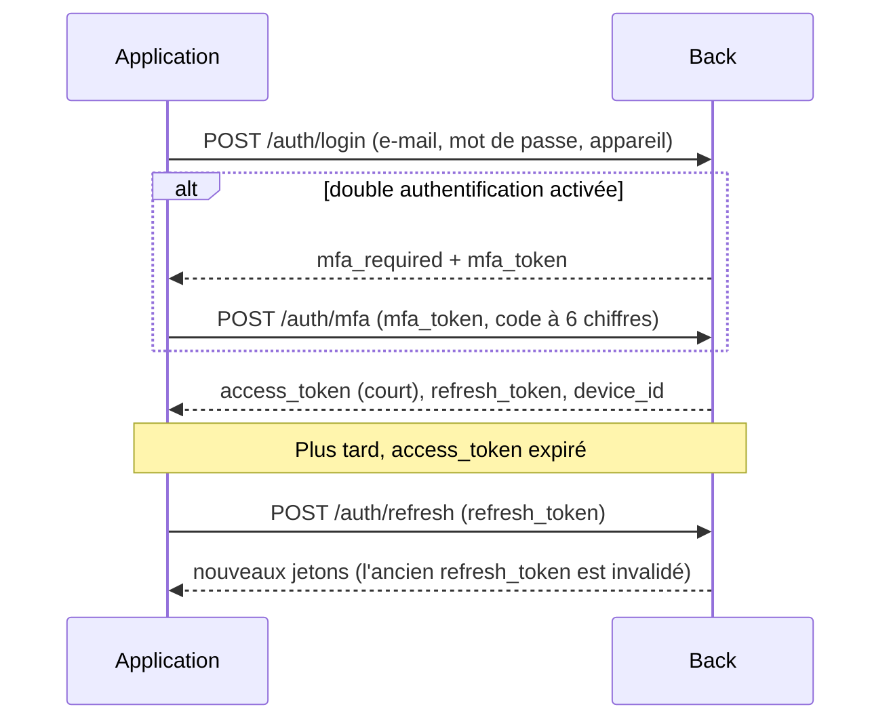
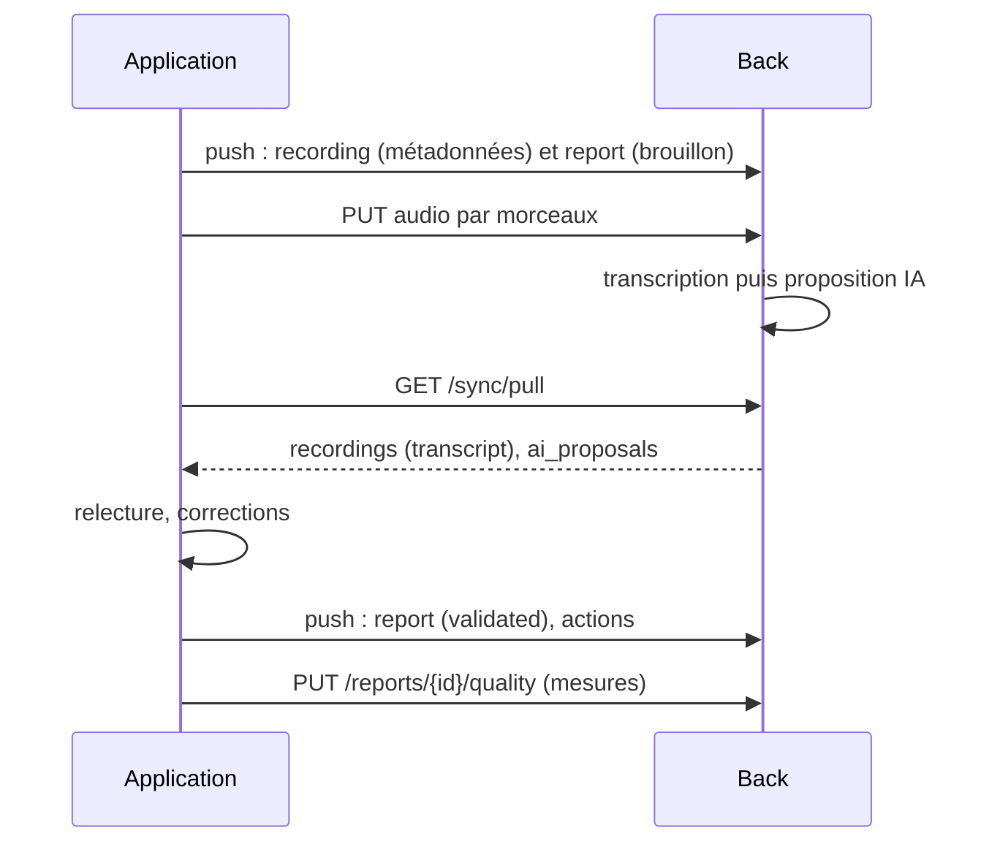

# Contrat des API — v0.1

Trois API distinctes, décrites en OpenAPI 3.1 dans le dossier [`api/`](../api) :

| API | Fichier | Utilisateur | Authentification |
|-----|---------|-------------|------------------|
| Mobile | [`mobile.openapi.yaml`](../api/mobile.openapi.yaml) | Application iOS / Android | Jeton d'accès court + jeton de renouvellement |
| CRM | [`crm.openapi.yaml`](../api/crm.openapi.yaml) | Le CRM interne | Clé d'API (compte de service) |
| Administration | [`admin.openapi.yaml`](../api/admin.openapi.yaml) | Console d'administration (IT) | Jeton d'accès, droit administrateur |

Composants communs (erreurs, identifiants, énumérations) : [`common.yaml`](../api/common.yaml).

**Vérifié** : les quatre fichiers sont valides au sens de la spécification OpenAPI 3.1 (contrôle par un validateur automatique). **Non vérifié** : aucun serveur n'implémente ce contrat ; il n'a pas été confronté à un client réel. C'est un brouillon pour discussion, et le contrat CRM est une **proposition à soumettre à l'équipe CRM**, dont le format attendu est inconnu.

## 1. Conventions

- Base : `https://<hôte>/api/{mobile|crm|admin}/v1`. La version majeure est dans l'adresse ; on ne casse pas une version publiée, on en ouvre une nouvelle.
- Formats : JSON, UTF-8. Horodatages RFC 3339 en UTC. Dates seules (`due_date`) au format `AAAA-MM-JJ`. Identifiants en UUID.
- **Erreurs** : `application/problem+json` (RFC 9457) avec un champ `code` stable (voir §6).
- **Pagination** : curseur opaque (`cursor`, `next_cursor`, `has_more`) ; jamais de numéro de page.
- **Version de l'application** : en-tête `X-App-Version` sur toutes les requêtes mobiles. En dessous du minimum exigé, réponse **426** avec le code `upgrade_required`.
- **Visibilité** : une ressource que l'appelant n'a pas le droit de voir répond **404**, jamais 403, pour ne pas révéler son existence.
- **Limites de débit** : réponse **429** avec `Retry-After`. Valeurs à définir au dimensionnement ; propositions de départ : connexion 10 par minute et par adresse, synchro 60 par minute et par utilisateur.
- **Transport** : HTTPS uniquement.

## 2. Authentification (API mobile)

- Le jeton de renouvellement est **à usage unique** et tourne à chaque appel. Si un ancien jeton est présenté, la session de l'appareil est révoquée (indice de vol).
- Verrouillage du compte après échecs répétés (423, `account_locked`). Seuils à définir.
- Une désactivation de compte ou une révocation par l'administrateur coupe les sessions ; l'appareil efface ses données locales à la prochaine tentative.

## 3. Protocole de synchronisation (API mobile)

### 3.1 Lecture : `GET /sync/pull`

1. **Synchronisation initiale** : appel sans `cursor`. Le serveur renvoie la fenêtre hors-ligne de l'utilisateur (ses clients, ses visites des prochains jours, l'historique récent), en plusieurs lots tant que `has_more` vaut true.
2. **Synchronisation courante** : appel avec le dernier `next_cursor`.
3. Chaque ligne est appliquée par **remplacement sur l'identifiant** (idempotent). Une ligne avec `deleted_at` renseigné est supprimée localement.
4. **Recouvrement** : le curseur renvoyé relit volontairement un peu en arrière. La raison est technique : deux transactions simultanées peuvent valider dans un ordre différent de leur numéro de changement (voir `SCHEMA_DONNEES.md` §5). Appliquer deux fois la même ligne ne change rien. Ce mécanisme reste à éprouver avec le prototype de synchro.
5. **Retraits d'accès** : le tableau `revocations` liste les données que l'utilisateur ne voit plus (affectation retirée, changement de visibilité ou de hiérarchie). L'appareil les supprime.
6. **Curseur périmé** : 410 `cursor_expired` → refaire une synchronisation initiale.

**Point à valider** : pour un manager ou un directeur, la fenêtre « tout ce qui est en dessous » peut être très large. Il faudra probablement une fenêtre plus étroite pour eux (par exemple les visites récentes de leur équipe) ou un chargement à la demande.

### 3.2 Écriture : `POST /sync/push`

- Lots de 200 opérations au plus, traitées **dans l'ordre**.
- Chaque opération porte un `id` généré sur l'appareil. Rejouer une opération déjà traitée renvoie son résultat d'origine sans rien changer (idempotence : pas de doublon si la réponse s'est perdue).
- Résultat par opération : `applied`, `conflict` ou `rejected` (avec un `code`). Une opération rejetée n'arrête pas les suivantes, sauf celles qui en dépendent (`dependency_failed`).
- Ordre à respecter par l'appareil : visite avant compte rendu, note, enregistrement et pièce jointe ; enregistrement avant la note vocale qui le référence.

**Règles par entité**

| Entité | Création | Modification | Suppression | Fixé par le serveur |
|--------|----------|--------------|-------------|---------------------|
| `visit` | Sur un client que l'utilisateur peut lire | `location_text` (adresse) : voir ci-dessous ; tout le reste : auteur seul ; `base_version` requis ; `planned_start` seulement tant que la visite n'est pas commencée | Non : statut `cancelled` | `author_id`, version, historique |
| `visit_contact` | Le contact doit appartenir au client de la visite | — | Oui (logique) | |
| `report` | Un seul par visite, par l'auteur de la visite | Auteur seul ; `base_version` requis ; **brouillon** : tous les champs, dont `draft_actions` (actions prévues) ; passage à `validated` : **visite terminée** et `summary` non vide, crée les actions prévues ; **validé** : verrouillé, seule la remise en brouillon (`status: draft`) est acceptée | Non | `validated_at`, `validated_by`, version |
| `note` (notes durant visite) | Par l'auteur de la visite, **tant qu'elle n'est ni terminée, ni validée, ni annulée** | Champ `body` seulement, par l'auteur, même condition | Oui (logique), par l'auteur, même condition | `author_id` |
| `internal_note` | Par un **commercial** qui voit la visite | `body`, par l'auteur seul | Oui (logique), par l'auteur | `author_id`, `author_name` ; lecture : l'auteur et sa hiérarchie (lecture seule) |
| `private_note` | Une par visite et par auteur | Auteur seul ; `base_version` requis | Oui (logique) | `author_id` |
| `action` | **Depuis une visite** (`visit_id` requis, par son auteur) dont le **compte rendu est validé** ; sinon `locked_status`. Les actions issues du brouillon sont créées par le serveur à la validation | `title`, `due_date`, `reminder`, `status` ; `base_version` requis | Non : statut `cancelled` | `author_id`, `owner_id` (= auteur dans le MVP), `completed_at`, version |
| `recording` | Métadonnées ; l'audio est envoyé séparément | — | Non | `status`, `purge_after` |
| `attachment` | Métadonnées ; photo envoyée séparément | `caption` | Oui (logique) | |
| `glossary_term` | Termes personnels seulement | Auteur seul | Oui (logique) | `scope` = user |

**Règles de fin de visite (migration 006).** (1) Validation d'un compte rendu sans action prévue ni action déjà créée : `no_action: true` exigé (`validation_failed`). (2) Remise en brouillon refusée si `sent_to_client_at` est renseigné (`locked_status`). (3) Annulation d'une visite refusée tant qu'une action est à faire (`locked_status`). (4) Échéance d'une action (ou action prévue) antérieure à la date de la visite (début réel, sinon date prévue ; tolérance d'un jour) : `validation_failed`. (5) Le serveur ajoute à l'historique les événements `report_validated`, `report_reopened`, `visit_deleted`. (6) Notes internes : l'ajout reste possible, mais modification et suppression sont refusées (`locked_status`) une fois le compte rendu validé. **Étapes affichées** : `done` = « Effectuée » (le commercial a quitté le client) ; `validated` = « CR validé » ; une visite `validated` sans aucune action `todo` est « Terminée » (déduit côté application et CRM, pas un statut stocké).

**E-mail d'une visite.** `GET /visits/{id}/email-options` (destinataires = soi + supérieurs, contenu disponible, `configured`) et `POST /visits/{id}/email` (`recipient_ids`, `parts` parmi `report` | `actions` | `notes`, `message`). SMTP du back (variables `SMTP_*`), jamais le client, jamais les notes internes ou privées, compte rendu validé seulement, journal `visit_email`, limite `EMAIL_RATE_PER_HOUR`. Erreurs : 403 destinataire, 409 `report_not_validated`, 429, 502 `email_failed`, 503 `email_unavailable`. Détail dans `api/mobile.openapi.yaml`.

**Visites : statuts et adresse.** Statuts : `planned` (à organiser), `organized` (organisée avec le client), `in_progress`, `done`, `cancelled`, `deleted`. Transitions : à organiser → organisée, en cours ou annulée ; organisée → à organiser, en cours ou annulée ; en cours → terminée ou annulée ; terminée → validée **par le serveur seulement**, quand le compte rendu est validé (une opération qui demande `validated` est refusée) ; validée et annulée sont définitives (refus `locked_status`). **Suppression** : tout statut → `deleted` (définitif), réservée à l'auteur commercial ou à un directeur qui voit la visite (sinon `forbidden`), refusée tant qu'une action `todo` est liée à la visite (`locked_status`) ; une visite supprimée n'accepte plus de modification, de compte rendu, d'action ni de note interne (`locked_status`). **Adresse de la visite** (`location_text`, copiée du client à la création, elle ne suit pas ensuite le client) : modifiable par toute personne qui voit la visite tant qu'elle est « à organiser » ; par un commercial seulement une fois « organisée » ; par personne dès qu'elle est commencée. Une opération qui mêle l'adresse et un champ réservé à l'auteur est refusée en bloc. **Historique** : chaque modification de la date prévue et de l'adresse est enregistrée par le serveur (ancienne et nouvelle valeur, auteur, date) et reçue par `pull` (`visit_history`, lecture seule) par ceux qui voient la visite ; le CRM la lit par `/visit-history`.

`owner_id` n'est pas modifiable dans le MVP : l'assignation à un collègue viendra après le MVP.

### 3.3 Conflits

- Si `base_version` ne correspond plus à la version serveur, le serveur compare les **champs modifiés** des deux côtés. Pas de chevauchement : l'opération s'applique. Chevauchement sur un champ court : la valeur du serveur l'emporte (`server_wins`), signalée dans `conflict.fields`. Chevauchement sur un texte long (compte rendu, note) : les deux versions sont conservées (`both_kept`), l'utilisateur est alerté et choisit.
- **Mise en œuvre à valider** : savoir quels champs ont changé côté serveur depuis `base_version` suppose un historique des modifications par champ (le journal des opérations, complété par les changements issus du CRM ou de l'administration). C'est à éprouver dans le prototype.

### 3.4 Fichiers

- **Audio** : `PUT /recordings/{id}/content` par morceaux avec `Content-Range` ; `HEAD` donne l'octet de reprise (`Upload-Offset`). Un morceau rejoué est sans effet. À la réception du dernier octet, le serveur lance la transcription. La ligne `recording` doit exister (créée par `push`).
- **Photos** : `PUT /attachments/{id}/content` (JPEG ou PNG) ; téléchargement soumis à la visibilité de la visite.
- Les tailles maximales sont à fixer ; au-delà : 413 `payload_too_large`.

### 3.5 Voix et IA

- La proposition arrive par `pull` (`ai_proposals`) avec le texte source, les passages modifiés et les avertissements du contrôle automatique (nombre ou nom absent de la dictée).
- **Moment autorisé** : la génération n'est acceptée que si la visite est **en cours ou terminée** et que le **compte rendu n'est pas validé** ; sinon 409 `ai_not_available`.
- **Implémenté (première tranche, voir `IA_MISTRAL.md`)** : `POST /reports/{id}/ai-proposals` avec `source_text` renvoie **tout de suite** la proposition et ses avertissements (réponse 200, pas de traitement asynchrone, entrée texte seulement). Réponses : 402 `quota_exceeded`, 403 si l'appelant n'est pas l'auteur, 429, 502 `ai_failed`, 503 `ai_unavailable` (pas de clé). Le traitement asynchrone à partir de l'audio reste à faire ; `GET /usage` aussi.
- **L'IA ne crée rien directement** : les actions proposées ne deviennent des actions qu'après validation par l'utilisateur, via `push`.
- **Implémenté (première tranche vocale)** : `POST /visits/{id}/transcriptions` reçoit l'audio brut (25 Mo au plus) et renvoie le texte transcrit par Voxtral, **sans conserver l'audio ni le texte** ; en ligne seulement. Ce n'est pas encore le circuit prévu (enregistrements créés hors-ligne, envoi différé par morceaux, traitement asynchrone).
- `PUT /reports/{id}/quality` n'envoie que des mesures (jamais de contenu). `POST /error-reports` reçoit les signalements des utilisateurs.

## 4. API CRM

- **Lecture seule** : `visits`, `reports` (validés seulement), `notes`, `actions`.
- **Exclus** : notes privées, audio, transcriptions, propositions de l'IA, photos.
- **Aucune règle de visibilité hiérarchique** : le CRM lit tout ce qui est exposé.
- Les clients sont identifiés par leur **identifiant CRM** (`company_crm_id`) ; les auteurs et responsables par leur e-mail.
- **Lecture incrémentale recommandée**
  1. Première fois : `updated_since` à la date de départ souhaitée (ou rien pour tout lire), puis suivre `next_cursor`.
  2. Ensuite : rappeler avec le dernier `next_cursor`, à la fréquence voulue.
  3. Garder `include_deleted=true` (par défaut) pour apprendre qu'une ligne a été supprimée ou annulée.
  4. **Traiter chaque ligne en « insérer ou remplacer » sur `id`** : un recouvrement peut renvoyer une ligne déjà vue ; comparer `seq` ou `updated_at` pour ignorer une version plus ancienne.
- Clés d'API : transmises en `Authorization: Bearer`. Deux clés peuvent être valides à la fois pour un renouvellement sans interruption. Les clés sont stockées hachées côté back et renvoyées en clair une seule fois à la création.

## 5. API d'administration

- Utilisateurs (création avec lien d'activation à usage unique, modification, réinitialisation du mot de passe et du deuxième facteur, révocation des sessions).
- Affectations client-commerciaux (corrections de source `admin`) et rattachement manuel d'un client fusionné.
- Réglages, dont `report_visibility_mode`. **Garde-fou** : modifier le mode refuse l'appel (409 `impact_confirmation_required`) tant que l'administrateur n'a pas confirmé, en lui donnant le nombre de visites qui deviendront visibles ou invisibles. Les retraits d'accès sont calculés ensuite par une tâche.
- Comptes de service et clés, historique des synchronisations CRM → back et lancement manuel.
- Journal d'audit (jamais de contenu de compte rendu).
- Les administrateurs **n'ont pas accès au contenu des visites** par ce seul rôle (à confirmer).

## 6. Codes d'erreur

| HTTP | `code` | Cas |
|------|--------|-----|
| 400 | `validation_failed` | Champ invalide ou manquant (détail dans `errors`) |
| 401 | `invalid_credentials`, `token_expired` | Identifiants incorrects ; jeton expiré ou invalide |
| 402 | `quota_exceeded` | Plafond mensuel d'IA atteint |
| 403 | `forbidden` | Droits insuffisants |
| 404 | `not_found` | Inconnu **ou non visible** |
| 409 | `already_processing`, `already_running`, `email_taken`, `hierarchy_cycle`, `impact_confirmation_required` | Conflit d'état |
| 410 | `cursor_expired` | Curseur périmé |
| 413 | `payload_too_large` | Fichier trop volumineux |
| 423 | `account_locked` | Compte verrouillé |
| 426 | `upgrade_required` | Application trop ancienne |
| 429 | `rate_limited` | Trop de requêtes |

Pour `push`, les codes d'une opération rejetée (`validation_failed`, `forbidden`, `not_found`, `dependency_failed`, `quota_exceeded`, `locked_status`) sont renvoyés dans le résultat de l'opération, pas dans le statut HTTP de la requête.

## 7. Points à valider

1. **Format CRM** : champs, fréquence, historique initial, authentification : à confronter à l'équipe CRM. Le contrat actuel est une proposition.
2. **Comptes rendus validés modifiables** après validation ? Hypothèse : oui, par l'auteur, avec nouvelle version visible du CRM.
3. **Condition de validation** d'un compte rendu : résumé non vide ; autres champs obligatoires éventuels.
4. **Portée de synchro des managers et directeurs** (fenêtre plus étroite ou chargement à la demande).
5. **Seuils** : limites de débit, verrouillage de compte, tailles maximales des fichiers, durée de vie des jetons.
6. **Détection de conflit par champ** : mise en œuvre à éprouver (§3.3).
7. **Notifications** : aucune notification push dans ce contrat ; l'appareil récupère les résultats de l'IA par `pull`. Si une notification est souhaitée pour signaler qu'une proposition est prête, il faudra l'ajouter (et choisir un service compatible avec l'hébergement UE).
