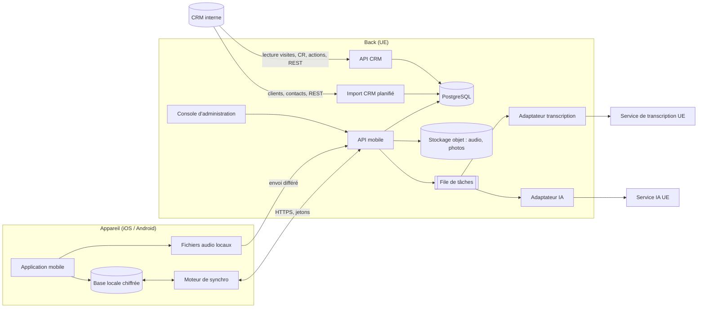

# Architecture technique — v0.1 (brouillon)

Les choix marqués **[DÉCISION]** sont à valider. Aucun n'a été prototypé. Les noms de bibliothèques sont des candidats à vérifier (maintenance, licence, compatibilité), pas des engagements.

## 1. Contraintes qui structurent l'architecture

Issues de la spec (§1 bis) :
- Fonctionnement **hors-ligne** complet pour la consultation et la saisie.
- **> 50 utilisateurs**, 3 niveaux hiérarchiques, clients partagés entre commerciaux.
- **Hébergement UE** pour toutes les données, y compris audio, transcription et IA.
- **6 langues** (FR, EN, ES, IT, DE, NL), une langue de dictée par commercial.
- Parc **iOS + Android** (distribution et MDM hors périmètre de ce projet) ; comptes propres, **sans SSO**.
- Le **CRM** envoie les clients (lecture seule) et vient **tout récupérer** par API (hors notes privées et audio).
- Fournisseur de transcription/IA **non choisi** : il doit rester interchangeable.

## 2. Vue d'ensemble

## 3. Application mobile

**Choix [DÉCISION]** : application multiplateforme (un code pour iOS et Android, tablette comprise) plutôt que deux applications natives ou une PWA.
- La PWA est écartée : accès micro, enregistrement en arrière-plan, base locale chiffrée et biométrie y sont moins fiables, surtout sur iOS (à confirmer par un essai).
- **React Native + TypeScript** ou **Flutter** : les deux conviennent techniquement, et l'équipe maîtrise les deux (ainsi que Node), donc la compétence ne départage pas.
- **Choix provisoire : React Native + TypeScript**, pour une seule raison concrète : partager avec le back TypeScript les types, les schémas de validation et la logique de synchro (règles de conflit, formats d'opérations). Cela réduit le risque d'écart entre client et serveur, qui est le point délicat de ce projet.
- **Ce que Flutter apporterait** : rendu identique sur les deux systèmes et chaîne d'outils unique ; mais le langage diffère du back, donc pas de code partagé.
- **Ce qui reste à vérifier avant de confirmer** (premier jalon, sur un iPhone et un Android de développement) : enregistrement audio fiable en arrière-plan et après interruption, SQLite chiffré performant avec le volume prévu, notifications locales. Si l'un de ces points échoue avec React Native, on bascule sur Flutter.

Briques nécessaires :
| Besoin | Approche |
|--------|----------|
| Base locale | SQLite chiffré (SQLCipher ou équivalent) ; schéma proche du back |
| Audio | enregistrement local en fichier (format compressé), reprise après interruption (appel, verrouillage) |
| Secrets | trousseau iOS / Keystore Android pour les jetons ; déverrouillage biométrique |
| Rappels d'actions | notifications locales (fonctionnent hors-ligne) |
| Configuration | écran de configuration de l'URL du back à la première connexion ; le MDM est hors périmètre |
| i18n | catalogues de textes par langue, dès le premier écran |
| Tablette | mise en page en deux colonnes, mêmes écrans |

## 4. Synchronisation hors-ligne

**Principe** : l'appareil lit et écrit toujours dans sa base locale ; la synchro est un processus séparé.

- **Envoi (outbox)** : chaque création/modification locale ajoute une opération (id client UUID, type, charge utile, horodatage) à une file. Le back applique chaque opération de façon **idempotente** (rejouer une opération ne duplique rien).
- **Réception (pull)** : le back numérote chaque changement avec un compteur croissant. L'appareil demande « tout ce qui a changé après le compteur N » et reçoit aussi les suppressions logiques (*tombstones*).
- **Périmètre local** : seulement les clients de l'utilisateur, ses visites des N prochains jours et l'historique récent (réglable côté administration).
- **Conflits** : par champ, la dernière modification serveur gagne, sauf pour les textes longs (compte rendu, notes) : on conserve les deux versions et on alerte l'utilisateur. Les notes de visite sont de type « ajout seulement », ce qui évite la plupart des conflits.
- **Identifiants** : UUID générés sur l'appareil, pour créer hors-ligne sans collision.
- **État visible** : « synchronisé », « n en attente », « erreur » (maquette).

Alternative écartée à ce stade : une base répliquée clé en main. Elle réduirait le code de synchro mais ajoute une dépendance forte, à confronter à l'hébergement UE et au modèle de droits (visibilité par hiérarchie). À reconsidérer lors du prototype **[DÉCISION]**.

## 5. Back

**Choix proposé [DÉCISION]** : API REST en TypeScript (Node), PostgreSQL, fichiers (audio, photos) sur le serveur (volume ou stockage compatible S3 auto-hébergé), file de tâches adossée à PostgreSQL. Le tout tourne en conteneurs sur un serveur Docker (voir §15).
- Cohérent avec la stack existante du dépôt PMA (Node, Express, PostgreSQL, Docker) ; PostgreSQL gère bien la hiérarchie (requêtes récursives) et les journaux de changements.
- Déploiement en conteneurs avec Docker Compose ; sauvegardes chiffrées ; serveur interne situé dans l'UE.

**Modules**
1. **API mobile** : authentification, synchro (push/pull), upload audio/photos, paramètres.
2. **Autorisation** : applique la règle de visibilité (§6) à chaque lecture.
3. **Pipeline voix et IA** (§7).
4. **Import CRM** (§8).
5. **API CRM** (§9).
6. **Console d'administration** (web) : comptes, rôles, hiérarchie, affectation client-commerciaux, réglage de visibilité, quotas IA, glossaires, journaux de synchro et d'audit.

## 6. Modèle de droits

- **Hiérarchie** : table des rattachements (commercial → manager → directeur) ; accès « tout ce qui est en dessous » par requête récursive ou table de fermeture.
- **Affectation** : table client ↔ commerciaux (un client peut avoir plusieurs commerciaux).
- **Visibilité des CR** (réglage global, deux modes) :
  - mode 1 : visible par les commerciaux affectés au client et leur hiérarchie ;
  - mode 2 : visible par l'auteur et sa hiérarchie.
- **Note privée** : lisible par l'auteur uniquement, jamais envoyée à l'API CRM ni aux autres rôles.
- **Actions** : modifiables par leur responsable ; lecture par la hiérarchie.
- La règle est appliquée **au back**, pas seulement dans l'application. Le réglage est lu depuis une table de paramètres pour permettre un affinage ultérieur (équipe, client) sans refonte.
- Conséquence à gérer : un changement de mode ou d'affectation modifie ce qui est visible, donc ce qui doit être **retiré** des bases locales à la synchro suivante.

## 7. Pipeline voix et IA

1. L'appareil enregistre l'audio en local, l'envoie dès que le réseau le permet (reprise sur interruption).
2. Le back stocke l'audio (stockage objet UE, chiffré) et crée une tâche **transcription**.
3. Un **adaptateur de transcription** appelle le fournisseur retenu avec la langue de l'utilisateur et le glossaire ; le résultat (texte, horodatage, confiance) est enregistré.
4. Une tâche **IA** nettoie et structure le texte selon un modèle de compte rendu, extrait les actions et leurs échéances, en renvoyant un résultat structuré (JSON) validé par un schéma. L'IA n'écrit jamais directement dans les champs finaux.
5. Le résultat arrive sur l'appareil par la synchro (et une notification) ; le commercial relit et valide.
6. **Garde-fous** : texte d'origine conservé à côté de la version IA ; contrôle automatique que chaque nombre et nom propre du résultat figure dans la dictée ; quotas par utilisateur (budget de 30 €/mois) ; journal des appels (durée, coût, version de modèle).
7. **Purge de l'audio** selon la durée configurée.

**Interchangeabilité** : deux interfaces internes (`Transcripteur`, `ModèleIA`) avec une implémentation par fournisseur. Le choix du fournisseur se fait après le test comparatif (voir `COMPARATIF_FOURNISSEURS.md`).

**Mode dégradé** : dictée native du téléphone en secours quand le réseau manque et qu'un texte immédiat est utile ; qualité moindre, signalée à l'utilisateur.

## 8. Import CRM (CRM → back)

- Tâche planifiée toutes les 5 à 15 minutes : lecture incrémentale des clients et contacts par l'API REST du CRM.
- Table de correspondance identifiant CRM ↔ identifiant interne ; clients en **lecture seule** dans l'application.
- Client absent ou supprimé du CRM : **marqué inactif**, visites conservées. Fusion : rattachement au client absorbant si le CRM fournit son identifiant.
- Reprise sur erreur, nouvelle tentative avec délai croissant, respect des quotas du CRM, journal de chaque exécution.
- À confirmer avec l'équipe CRM : authentification, champs, quotas, gestion des suppressions.

## 9. API pour le CRM (back → CRM)

- API REST dédiée, **séparée de l'API mobile** (version, authentification, limites propres).
- Authentification par compte de service avec clé ou jeton à durée limitée, restreinte par adresse réseau si possible.
- Ressources : visites, comptes rendus (version validée), notes publiques, actions, participants, rattachements ; chacune avec `updated_at`, identifiant stable, statut et suppression logique.
- Lecture incrémentale : `updated_since` + curseur de pagination ; réponses idempotentes.
- **Exclus** : notes privées, audio brut.
- Documentation OpenAPI publiée pour l'équipe CRM.

## 10. Authentification et sécurité

- **Comptes propres** : mots de passe hachés avec un algorithme adapté (argon2id), double authentification (application d'authentification), verrouillage après échecs, réinitialisation par l'IT via la console.
- **Jetons** : jeton d'accès court + jeton de renouvellement révocable, lié à l'appareil ; révocation immédiate côté serveur.
- **Sur l'appareil** : base chiffrée, secrets dans le trousseau/Keystore, verrouillage biométrique ; révocation du compte côté serveur (l'appareil efface ses données locales à la prochaine connexion). L'effacement à distance par MDM est hors périmètre.
- **Transport** : TLS partout ; au minimum vérification du certificat du back.
- **Données** : chiffrement au repos (base, stockage objet), sauvegardes chiffrées, accès d'administration journalisés.
- **RGPD** : registre des sous-traitants (cloud, transcription, IA), contrats de sous-traitance, durées de conservation, droits d'accès et d'effacement, analyse d'impact à envisager (données de prospects et audio) **[à valider avec le responsable de la protection des données]**.

## 11. Environnements, livraison, exploitation

- Environnements : développement, recette, production ; données de test fictives.
- CI : tests unitaires et d'intégration du back, tests de la synchro, build des applications.
- **Distribution mobile** : hors périmètre de ce projet.
- Observabilité : journaux structurés, métriques (latence, taille de la file de synchro, échecs de transcription/IA, coûts), alertes. Aucun contenu de compte rendu dans les journaux.
- Montée de version : l'application vérifie une version minimale exigée par le back.

## 15. Infrastructure : serveur Docker interne

**Décisions (21/11)** : serveur Docker hébergé chez vous, en UE ; même réseau que le CRM ; indisponibilité acceptable de quelques heures, **sans perte de données**.

| Service (conteneur) | Rôle |
|---------------------|------|
| Reverse proxy | Terminaison TLS, certificats, limitation de débit ; seul point exposé à Internet |
| API | API mobile, API CRM, console d'administration (fichiers statiques) |
| Worker | Transcription, IA, import CRM, purge de l'audio |
| PostgreSQL | Données, journal des changements, file de tâches |
| Stockage de fichiers | Audio et photos : volume dédié ou stockage compatible S3 auto-hébergé (licence à vérifier) |
| Supervision | Journaux et métriques (facultatif au début) |

- **Exposition** : les téléphones sont hors de votre réseau ; le reverse proxy doit être joignable depuis Internet (nom de domaine, certificat valide, pare-feu fermant tous les autres ports, limites de débit). Prévoir une zone réseau isolée (DMZ) entre Internet et le réseau interne, car le serveur est sur le même réseau que le CRM. À valider avec votre sécurité informatique.
- **Sorties réseau** : le serveur doit joindre les services de transcription et d'IA retenus ; on limite les sorties à ces destinations.
- **« Sans perte de données »** : une sauvegarde quotidienne ne suffit pas, elle peut perdre jusqu'à 24 h de données. Il faut un archivage continu de PostgreSQL (journaux de transaction) et une copie fréquente des fichiers, chiffrés, **hors du serveur** (en UE), avec essais de restauration réguliers. Une partie des données récentes existe aussi sur les appareils tant qu'elle n'est pas synchronisée, mais cela ne remplace pas la sauvegarde. Sans second serveur, la restauration prend quelques heures, ce qui correspond à votre tolérance.
- **Mises à jour** : images versionnées, Docker Compose, migrations automatisées avec sauvegarde préalable. L'outillage de migration PostgreSQL du dépôt PMA peut servir de modèle.
- **Secrets** : hors dépôt et hors images.
- **Capacité** : à dimensionner (processeur, mémoire, disque pour l'audio, bande passante) : voir §12. Disque : l'audio brut est purgé après la durée configurée.
- **Transcription et IA** : services externes en UE ; les héberger soi-même demanderait du matériel adapté (cartes graphiques), non prévu.
- **Questions restantes** : qui administre le serveur ? quel stockage de sauvegarde hors serveur ? quelle équipe sécurité valide l'exposition Internet ?

## 12. Dimensionnement indicatif

Hypothèses : 50 à 200 utilisateurs, 10 h d'audio par utilisateur et par mois.
- Audio : 500 à 2 000 h par mois à transcrire, soit quelques dizaines de gigaoctets selon le format.
- Visites : de l'ordre de quelques milliers par mois ; la charge sur PostgreSQL est faible.
- Le point sensible est la **concurrence de la file de transcription/IA** en fin de journée (tous les commerciaux dictent en même temps), pas le volume de données.

## 13. Risques techniques principaux

| Risque | Effet | Parade |
|--------|-------|--------|
| Qualité de transcription insuffisante (NL, IT, jargon) | Adoption faible | Test comparatif avant de coder la partie IA ; glossaires ; correction manuelle toujours possible |
| Complexité de la synchro et des droits | Fuites de données ou conflits | Prototype dès la phase 0 ; tests dédiés ; règle de visibilité appliquée au back |
| Retrait de données visibles (changement de visibilité) | Données obsolètes sur les appareils | Tombstones et purge locale à la synchro |
| API du CRM inconnue | Estimation de l'intégration impossible | Obtenir la documentation tôt ; adaptateur isolé |
| Comptes propres sans SSO | Charge de sécurité sur le projet | Double authentification, console IT, journal d'audit ; réexaminer un SSO |
| Dépendance à un fournisseur IA/transcription | Coût, disponibilité, conformité | Adaptateurs, double fournisseur possible, quotas |
| Pas de test de qualité avant le développement | Qualité insuffisante dans certaines langues découverte tard | Lancement langue par langue, mesure intégrée au produit, fournisseur interchangeable |
| Serveur Docker unique | Panne = indisponibilité de la synchro, de la transcription et de l'IA (l'application continue hors-ligne) | Sauvegardes continues et restaurations testées, §15 |

## 14. Phasage proposé

0. **Préparation réduite** : prototype de synchro et de visibilité, premier jalon mobile (audio en arrière-plan), sélection documentaire des fournisseurs, mesure de qualité intégrée (voir `PHASE0_PLAN.md`).
1. **Socle back** : modèle de données, authentification, droits, console d'administration minimale.
2. **Application hors-ligne** : clients, visites, comptes rendus manuels, actions, synchro.
3. **Voix et IA** : enregistrement, transcription, structuration, relecture.
4. **Intégration CRM** : import des clients, API de lecture pour le CRM.
5. **Pilote** : groupe restreint, mesure de la qualité et du coût, puis déploiement.

Les phases 3 et 4 peuvent se dérouler en parallèle une fois la phase 2 stabilisée.
