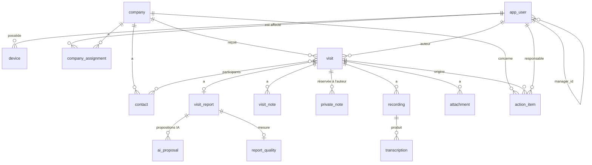

# Schéma de données — v0.1

Le schéma exécutable est dans [`db/schema.sql`](../db/schema.sql) (PostgreSQL 16). Il se charge sans erreur sur une base vide et les règles de visibilité sont vérifiées par [`db/tests/visibility_test.sql`](../db/tests/visibility_test.sql). **Il n'a pas été éprouvé en charge ni avec le prototype de synchro** : c'est une base de départ.

## 1. Vue d'ensemble

| Domaine | Tables |
|---------|--------|
| Référentiels et réglages | `language`, `visit_type`, `app_setting` |
| Utilisateurs | `app_user`, `user_hierarchy`, `device`, `refresh_token` |
| CRM (lecture seule dans l'appli) | `company`, `contact`, `company_assignment` |
| Visites | `visit`, `visit_contact`, `visit_history`, `visit_report`, `visit_note`, `private_note`, `attachment` |
| Voix et IA | `recording`, `transcription`, `ai_proposal`, `report_quality`, `error_report`, `ai_usage`, `glossary_term` |
| Actions | `action_item` |
| Synchro | `client_operation`, `access_revocation`, `text_conflict` |
| Intégration et sécurité | `crm_sync_run`, `service_account`, `audit_log` |
| Lecture pour le CRM | vues `crm_visit`, `crm_report`, `crm_note`, `crm_action` |

## 2. Principes

1. **Identifiants** : les entités créées par l'appareil (visite, compte rendu, note, action, enregistrement, pièce jointe) ont un UUID **généré sur l'appareil**, pour créer hors-ligne sans collision. Les entités qui viennent du CRM ont un UUID interne plus une colonne `crm_id`.
2. **Compteur de changements `seq`** : une séquence globale numérote chaque insertion ou modification (déclencheur `bump_seq`). L'appareil demande « tout ce qui a un `seq` supérieur à N ».
3. **Suppression logique** : `deleted_at` (ou `removed_at` pour les liens) pour que la suppression soit transmise à la synchro et à l'API du CRM. Les actions ne sont pas supprimées mais « annulées ».
4. **Version** (`version`) sur les entités éditables, pour détecter les modifications concurrentes.
5. **Note privée dans une table à part** : `private_note` n'est référencée par aucune vue, aucune règle de visibilité hiérarchique, aucune vue du CRM. La séparation physique évite qu'une jointure ou une vue l'expose par erreur.
6. **Audio, transcriptions et propositions IA** : stockés dans des tables que les vues du CRM n'incluent pas.
7. **Langues** : table `language` plutôt qu'une liste figée, avec un drapeau `enabled` pour l'ouverture langue par langue.
8. **Réglages** : table `app_setting` en clé/valeur. `report_visibility_mode` (1 ou 2) est global pour l'instant ; il peut être affiné plus tard sans changer le schéma des données métier.

## 2 bis. Visites : statuts, adresse, historique (migration 001)

- Statuts : `planned` (à organiser), `organized` (organisée avec le client), `in_progress`, `done`, `validated` (terminée avec compte rendu validé, attribué par le serveur, migration 002), `cancelled`, `deleted` (visite supprimée, migration 005 : conservée, synchronisée, masquée par défaut dans l'application).
- `visit.location_text` est l'**adresse de la visite**, copiée du client à la création : elle ne suit pas les changements du client.
- `visit_history` : une ligne par modification de la date prévue ou de l'adresse (ancienne valeur, nouvelle valeur, nom de la personne copié au moment de la modification, date). Écrite par le serveur seulement ; lue par ceux qui voient la visite ; exposée au CRM par la vue `crm_visit_history`.
- Les bases existantes sont mises à niveau par `db/migrations/001_visite_organisee_et_historique.sql`, appliquée automatiquement au démarrage (table `schema_migrations`).

## 2 quater. Actions prévues (migration 004)

Table `visit_email` (migration 007) : journal des envois d'e-mail d'une visite (visite, expéditeur, adresses, parties, résultat, erreur tronquée ; le contenu n'est pas conservé).

`visit_report.no_action` (boolean, « aucune action à prévoir », migration 006) et `visit_report.sent_to_client_at` (transmission au client : verrouille la remise en brouillon ; aucune fonction ne l'alimente encore). `visit_history.field` accepte aussi `report_validated`, `report_reopened`, `visit_deleted` (événements sans valeur ancienne/nouvelle).

`visit_report.draft_actions` (jsonb, tableau d'éléments `{id, title, due_date, origin}`) : actions **prévues** dans le brouillon du compte rendu. À la validation, le serveur crée de vraies lignes `action_item` (mêmes identifiants, responsable = auteur de la visite, origine `ai` ou `manual`) dans la **même transaction** puis vide la liste. Une action n'existe donc jamais avant la validation, sauf ajout manuel depuis une visite dont le compte rendu est déjà validé. `action_item.visit_id` est renseigné pour toute action créée par l'application.

## 2 ter. Notes internes (migration 003)

`internal_note` : id, visite, auteur, **nom de l'auteur copié à la création**, texte, dates, suppression logique. **Lisible par l'auteur et par sa hiérarchie** (fonction `can_read_internal_note`, fermeture de hiérarchie), **indépendamment du mode de visibilité** des comptes rendus. Aucune vue du CRM ne l'expose ; elle n'entre ni dans le compte rendu ni dans la génération par IA. Un changement de supérieur produit des retraits d'accès pour l'ancienne hiérarchie.

## 3. Hiérarchie

`app_user.manager_id` donne le supérieur direct. `user_hierarchy` est la **fermeture transitive** (ancêtre, descendant, profondeur, avec la profondeur 0 pour l'utilisateur lui-même), reconstruite par `rebuild_hierarchy()` à chaque changement de rattachement. Elle évite des requêtes récursives à chaque lecture. Garde-fou : profondeur limitée à 10 pour éviter une boucle si un cycle est saisi par erreur.

## 4. Règles de visibilité (fonctions SQL)

| Donnée | Qui la lit |
|--------|-----------|
| Visite et compte rendu, **mode 2** | l'auteur et sa hiérarchie |
| Visite et compte rendu, **mode 1** | mode 2, plus les commerciaux affectés au client et leur hiérarchie |
| Client et contacts | les commerciaux affectés et leur hiérarchie |
| Action | l'auteur, le responsable et la hiérarchie du responsable |
| Note privée | l'auteur seul |
| Audio, transcription, proposition IA | l'auteur (et le traitement serveur) |

Vérifié par le test sur un cas à deux équipes. Pour une visite de C1 chez un client où C1 et C3 sont affectés (C1 dépend de Mgr, C3 de Mgr2, tous deux de Dir) :

| Utilisateur | Mode 2 | Mode 1 |
|-------------|--------|--------|
| C1 (auteur) | oui | oui |
| C2 (même équipe, non affecté) | non | non |
| C3 (affecté au client) | non | oui |
| Mgr | oui | oui |
| Mgr2 | non | oui |
| Dir | oui | oui |

Points à valider :
- **Les administrateurs IT ne voient pas le contenu** par leur seul rôle `is_admin` : ils gèrent les comptes, pas les comptes rendus. À confirmer.
- **Un manager voit les visites de ses subordonnés** même sur des clients où il n'est pas affecté (mode 2 : par la hiérarchie de l'auteur).

## 5. Synchronisation

- **Réception** : pour chaque table, `WHERE seq > :curseur`, filtré par la règle de visibilité de l'utilisateur. Le résultat inclut les lignes supprimées logiquement.
- **Envoi** : chaque opération de l'appareil a un identifiant unique enregistré dans `client_operation`. Rejouer la même opération ne produit aucun effet (idempotence). Le résultat est `applied`, `conflict` ou `rejected`.
- **Retrait d'accès** : quand une donnée cesse d'être visible pour un utilisateur (affectation retirée dans le CRM, changement de mode de visibilité, changement de hiérarchie), une ligne est ajoutée à `access_revocation`. L'appareil la lit à la synchro suivante et supprime la donnée de sa base locale. Un changement de mode global produit potentiellement beaucoup de lignes ; il doit être calculé par une tâche, pas en ligne.
- **Conflits** : champs courts, la dernière modification serveur gagne ; textes longs, on conserve les deux versions dans `text_conflict` et on alerte l'utilisateur ; notes de visite, ajout seulement.

**Risque connu à tester dans le prototype** : avec un compteur global, deux transactions simultanées peuvent valider dans un ordre différent de leur `seq`. Un appareil qui a déjà avancé son curseur peut alors **manquer** une ligne. Parades à évaluer : relire avec un léger recouvrement (appliquer deux fois la même ligne ne change rien), ou calculer le curseur à partir de la position des transactions en cours. J'ai ajouté ce cas au prototype de synchro (scénario 9, voir `PHASE0_PLAN_COMPLET.md` §5).

## 6. Actions

`action_item` porte `author_id` et `owner_id` séparés. Dans le MVP, une contrainte impose `owner_id = author_id`. L'assignation à un collègue (après le MVP) consiste à **retirer cette contrainte** et à ajouter les droits de modification correspondants : aucune migration de données n'est nécessaire. Le test vérifie que la contrainte refuse bien une assignation.

## 7. Voix, IA et mesure de qualité

- `recording` : fichier audio (clé de stockage), langue, état d'avancement, date de purge. `storage_key` redevient `NULL` après purge ; la ligne est conservée pour l'historique.
- `transcription` : texte, fournisseur, version du modèle, confiance, coût. Fournisseur et modèle sont enregistrés pour pouvoir comparer des fournisseurs sur des données réelles.
- `ai_proposal` : proposition structurée (JSON), texte source, résultat du contrôle des chiffres et noms. Conservée à côté du compte rendu final.
- `report_quality` : mesures à la validation (acceptée sans modification, part de texte modifiée, chiffres et noms modifiés, durée de relecture, abandon vers la saisie manuelle). **Aucun contenu**, seulement des mesures. C'est ce qui remplace le test préalable décrit dans `PHASE0_PLAN.md`.
- `error_report` : signalements des utilisateurs, par catégorie.
- `ai_usage` : consommation et coût, pour appliquer le plafond mensuel (`app_setting.ai_monthly_budget_cents`, surchargeable par utilisateur).

## 8. Vues pour l'API du CRM

- `crm_visit`, `crm_report`, `crm_note`, `crm_action` : lecture seule, avec `seq`, `updated_at` et `deleted_at` pour la lecture incrémentale et les suppressions.
- **Pas de règle de visibilité hiérarchique** : le compte de service du CRM lit tout ce que les vues exposent.
- **Exclus par construction** : notes privées, audio, transcriptions, propositions IA.
- `crm_report` ne contient que les comptes rendus **validés** : un brouillon peut contenir une proposition de l'IA non relue. À confirmer avec l'équipe CRM.
- Les photos (`attachment`) ne sont pas exposées dans cette version.

## 9. Décisions et hypothèses à valider

1. Les administrateurs IT ne lisent pas le contenu des visites.
2. Le CRM ne reçoit que les comptes rendus validés, et pas les photos.
3. Les statuts, types et catégories sont des listes fermées (contraintes `CHECK`) ; les types de visite sont dans une table pour être administrables.
4. Température d'opportunité : trois valeurs (froid, tiède, chaud). Valeurs à confirmer avec les commerciaux.
5. Rappel d'action : trois choix (aucun, jour même 9 h, veille 17 h), repris de la maquette.
6. Un seul compte rendu par visite (`visit_report.visit_id` unique). Si une visite peut avoir plusieurs comptes rendus (par exemple un complément ultérieur), il faut lever cette contrainte.
7. Une seule note privée par auteur et par visite.

## 10. Hors périmètre de ce schéma

Pièces jointes autres que photos, itinéraires et géolocalisation (V2), opportunités et statuts commerciaux (non envoyés par le CRM), notifications push, modèles de compte rendu personnalisables, partitionnement et archivage des tables volumineuses (`audit_log`, `ai_usage`).
